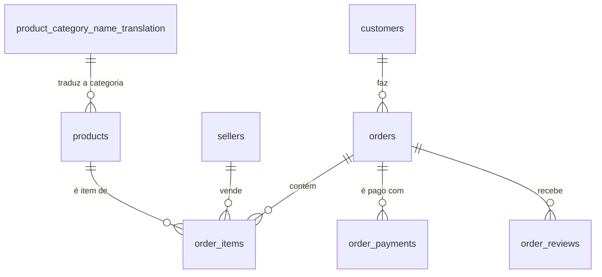
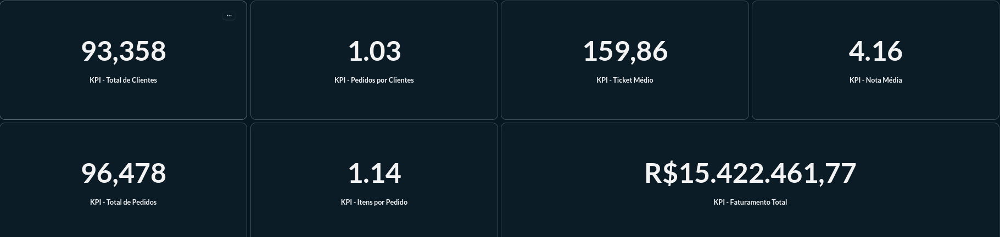
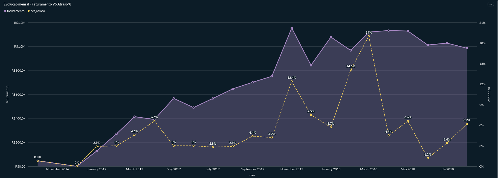
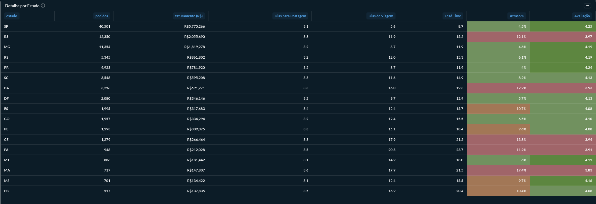
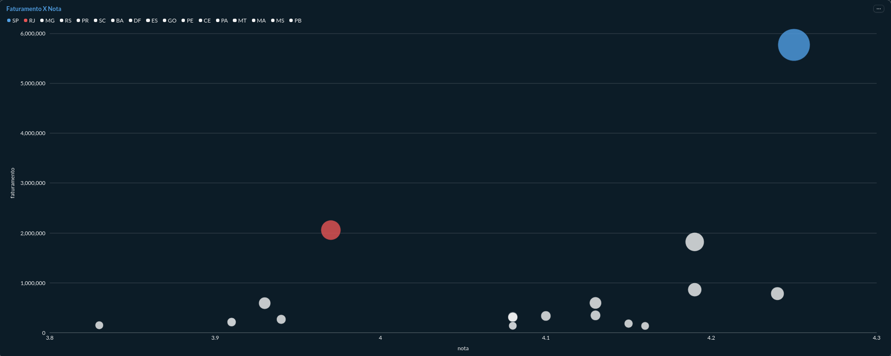
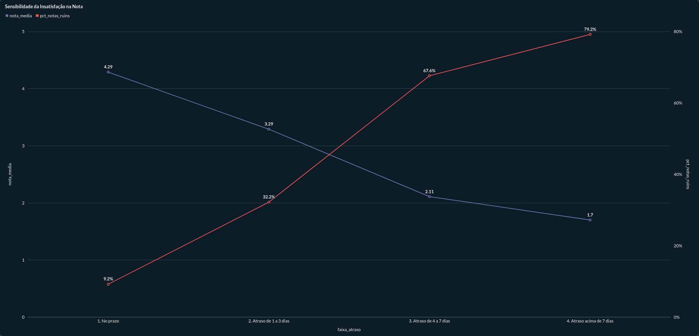
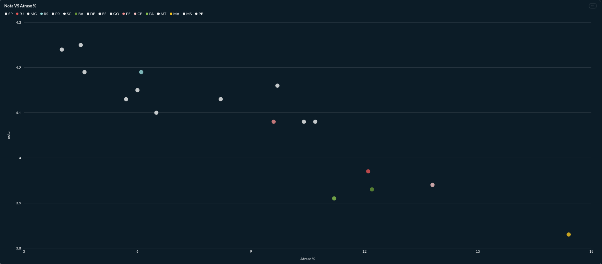
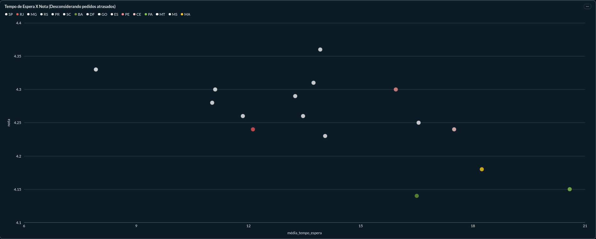
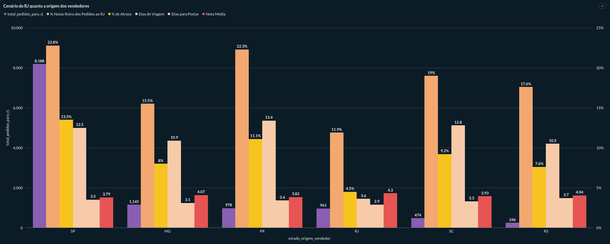

# Olist · Satisfação e entregas no Rio de Janeiro (2016–2018)

> **O Rio de Janeiro é o 2º maior mercado da Olist, mas tem a pior nota entre os grandes estados. O que explica isso e onde a operação deveria agir?**

📑 [Apresentação em slides (PDF)](apresentacao/olist_rj_satisfacao_entregas.pdf) · 📊 [Imagens do dashboard](imagens/) · 🧾 [Scripts SQL](sql/)

**Ferramentas:** PostgreSQL · DBeaver · Metabase · Canva

---

## Resumo em 30 segundos

| | |
|---|---|
| **O problema** | O RJ responde por 12.350 pedidos e R$ 2,06 mi (13,8% da receita dos 17 estados analisados), mas sua nota média é **3,97**, contra 4,16 no país. Entre os cinco maiores mercados, é o pior. |
| **A causa mais provável** | **Atrasos.** Pedidos no prazo recebem nota 4,29; com mais de 7 dias de atraso, 1,70. O RJ atrasa em **12,1%** dos pedidos, o dobro do RS (6,1%), embora os dois tenham o mesmo tempo médio de espera (~15 dias). O prazo prometido ao RJ é 2,2 dias menor que o do RS.
| **Onde a insatisfação se concentra** | Cerca de dois terços dos pedidos do RJ vêm de vendedores de SP. Esses pedidos têm **22,8% de notas 1 e 2**, contra **11,9%** dos vendedores do próprio RJ. |
| **O que fazer** | Hipóteses a testar: recalibrar o prazo estimado da rota SP→RJ, reduzir o tempo de trânsito com transportadoras ou malhas expressas e aproximar estoque do RJ. |

---

## 1. Problema de negócio

A Olist conecta pequenos lojistas aos grandes marketplaces do Brasil. O RJ é o segundo maior mercado em pedidos e em receita, mas é onde a satisfação do cliente fica mais atrás. Isso coloca em risco uma fatia relevante do negócio.

A análise busca responder:

1. O RJ é mesmo pior do que os outros grandes mercados?
2. O que explica a diferença: tempo de espera, atraso ou outra coisa?
3. Em que ponto da cadeia (vendedor ou transporte) o problema nasce?
4. Que ações a operação pode testar?

**Como o projeto foi conduzido.** A análise foi exploratória: as hipóteses (por exemplo, a da origem do vendedor) surgiram dos padrões encontrados nos dados, e não foram definidas antes. Por isso os resultados são evidências, e não prova de causa.

---

## 2. Os dados

- **Fonte:** [Brazilian E-Commerce Public Dataset by Olist](https://www.kaggle.com/datasets/olistbr/brazilian-ecommerce) (Kaggle). Pedidos feitos em marketplaces brasileiros entre 2016 e 2018, com 3.095 vendedores. O dataset tem 9 arquivos CSV; o projeto usa 8 tabelas (a de geolocalização ficou de fora, porque não é necessária para esta análise). Os dados seguem a licença indicada na página do dataset no Kaggle.
- **Escopo analisado:** somente pedidos com status `delivered`, ou seja, **96.478 pedidos (97% do total)**. Pedidos cancelados ou incompletos distorceriam receita e prazos. Todos ficam centralizados na view `vw_pedidos`.
- **Definições usadas:**
  - **Receita:** soma dos pagamentos do pedido (inclui frete).
  - **Faturamento por categoria e por vendedor** (seção 7, Blocos 6 a 8 do script): soma do preço dos itens, sem frete.
  - **Atraso:** entrega depois da data estimada (comparando apenas as datas, sem o horário).
  - **Dias de postagem:** da compra até a entrega à transportadora. **Dias de viagem:** da transportadora até o cliente.
  - **Nota:** média das avaliações do pedido. **Notas ruins:** notas 1 e 2.
  - **Estados:** apenas os 17 com pelo menos 500 pedidos.
  - **% de receita por estado:** calculado sobre o total dos 17 estados analisados.

### Auditoria de qualidade (antes das análises)

- **56.518 avaliações** sem comentário em texto. É o esperado, porque o texto é opcional.
- **2.980 pedidos** com datas ausentes e **160** sem data de aprovação do pagamento.
- **75 pedidos cancelados** com dados de logística preenchidos e **9 pedidos "entregues"** com rastreio corrompido.
- **610 produtos** sem categoria e **2** sem dimensões físicas.

### Modelo de dados



<details>
<summary>Ver a view <code>vw_pedidos</code> (base de todas as análises)</summary>

```sql
CREATE OR REPLACE VIEW vw_pedidos AS
WITH pagamento AS (
  SELECT order_id, SUM(payment_value) AS receita
  FROM order_payments
  GROUP BY order_id
),
itens AS (
  SELECT order_id, COUNT(*) AS qtd_itens
  FROM order_items
  GROUP BY order_id
),
avaliacao AS (
  SELECT order_id, AVG(review_score) AS nota
  FROM order_reviews
  GROUP BY order_id
)
SELECT
  o.order_id,
  c.customer_unique_id,
  c.customer_state AS estado,
  DATE_TRUNC('month', o.order_purchase_timestamp)::date AS mes,
  pg.receita,
  it.qtd_itens,
  av.nota,
  (o.order_delivered_customer_date::date - o.order_purchase_timestamp::date) AS dias_entrega,
  (o.order_delivered_customer_date::date - o.order_estimated_delivery_date::date) AS dias_atraso,
  (o.order_delivered_customer_date::date > o.order_estimated_delivery_date::date) AS atrasado,
  (o.order_delivered_carrier_date::date - o.order_purchase_timestamp::date) AS dias_postagem,
  (o.order_delivered_customer_date::date - o.order_delivered_carrier_date::date) AS dias_transporte
FROM orders o
JOIN customers c ON c.customer_id = o.customer_id
LEFT JOIN pagamento pg ON pg.order_id = o.order_id
LEFT JOIN itens it ON it.order_id = o.order_id
LEFT JOIN avaliacao av ON av.order_id = o.order_id
WHERE o.order_status = 'delivered';
```

</details>

---

## 3. Análise e achados

### 3.1 Panorama: o negócio cresceu rápido e a satisfação média é boa

**R$ 15,4 mi** de receita · **96.478** pedidos · **93.358** clientes · ticket médio de **R$ 159,86** · **1,14** itens por pedido · **1,03** pedido por cliente




A receita mensal cresceu até o fim de 2017 e se manteve em um patamar mais estável em 2018. A nota média, de 4,16, é alta. O ponto, portanto, não é uma insatisfação geral, e sim **onde** ela cai.

### 3.2 O RJ é o pior entre os grandes mercados

| Estado | Pedidos |    Receita |  Postagem (dias) | Viagem (dias) | Espera total (dias) | Atraso | Nota |
|---|---:|---:|---:|---:|---:|---:|---:|
|   SP   | 40.501  | R$ 5,77 mi |  3,1         |  5,6          |   8,7               |  4,5%  | 4,25 |
|   RJ   | 12.350  | R$ 2,06 mi | 3,3           |  11,9         |   15,2              | 12,1%  | 3,97 |
|   MG   | 11.354  | R$ 1,82 mi | 3,2           | 8,7 | 11,9 | 4,6% | 4,19 |
|   RS   | 5.345   | R$ 0,86 mi | 3,2 | 12,0 | 15,2 | 6,1% | 4,19 |
|   PR   | 4.923   | R$ 0,78 mi | 3,2 | 8,7 | 11,9 | 4,0% | 4,24 |

*O % de receita do RJ (13,8%) usa como base a soma dos 17 estados analisados (R$ 14,86 mi), e não o total da plataforma (R$ 15,42 mi).*

Entre os 17 estados com ao menos 500 pedidos, só MA, PA, BA e CE têm nota menor que a do RJ, mas os quatro juntos somam cerca de 6,2 mil pedidos, metade do volume do RJ. É no RJ que o problema pesa mais em volume.





### 3.3 O atraso está associado a notas mais baixas



Pedidos entregues no prazo têm nota média de **4,29**. Com mais de 7 dias de atraso, a nota cai para **1,7** e **79,2%** dos pedidos têm nota 1 ou 2. 6,8% dos pedidos totais da plataforma atrasam, mas esse grupo concentra a insatisfação.


### 3.4 RS × RJ: mesma espera, o dobro dos atrasos

| | Prazo prometido | Tempo de espera | Folga | Pedidos atrasados | Nota |
|---|---:|---:|---:|---:|---:|
| RS | 29,2 dias | 15,2 dias | 13,9 dias | 6,1% | 4,19 |
| RJ | 27,0 dias | 15,2 dias | 11,8 dias | 12,1% | 3,97 |

*Folga = prazo prometido − tempo de espera, em dias.*

Os dois estados esperam praticamente o mesmo tempo, mas o RJ atrasa **o dobro** e tem nota menor. O prazo prometido ao RJ é 2,2 dias menor que o do RS, o que deixa uma folga menor. A espera longa, sozinha, não explica a nota: o que parece pesar é **descumprir o prazo prometido** (associação, não prova de causa).

A folga, porém, não explica tudo. SP (11,1 dias), SC (11,5) e DF (12,0) têm folga parecida com a do RJ (11,8) e atrasam bem menos (4,5%, 8,2% e 5,7%). A hipótese é que o tempo de viagem do RJ varia mais, e a média esconde isso. A base permite testar essa hipótese (ver *Próximos passos*).



### 3.5 Sem os pedidos atrasados, as notas se aproximam



Ao refazer a análise **sem os pedidos atrasados**, as notas dos estados sobem e ficam na média de 4,26 , e o RJ passa a ficar em 4,24, mesmo com 12,1 dias de espera média. É um indício de que o atraso, mais do que a distância, está por trás de boa parte da diferença do RJ. Excluir os atrasados é uma análise condicional: ela mostra que, entre os pedidos entregues no prazo, os estados ficam parecidos, mas não prova que o atraso causa a diferença. A comparação usa os mesmos 17 estados da seção 3.2.


### 3.6 De onde vêm os pedidos do RJ: a rota SP→RJ concentra o problema

Para os pedidos entregues no RJ, a análise separou o resultado pelo **estado de origem do vendedor** (origens com pelo menos 100 pedidos).

| Origem do vendedor | Pedidos para o RJ | % dos pedidos do RJ | Postagem (dias) | Viagem (dias) | Atraso | Notas 1 e 2 | Nota |
|---|---:|---:|---:|---:|---:|---:|---:|
| SP | 8.188 | 66,3% | 3,5 | 12,5 | 13,5% | 22,8% | 3,79 |
| MG | 1.145 | 9,3% | 3,1 | 10,9 | 8,0% | 15,5% | 4,07 |
| PR | 978 | 7,9% | 3,4 | 13,4 | 11,1% | 22,3% | 3,82 |
| **RJ (local)** | **961** | **7,8%** | **2,9** | **3,6** | **4,5%** | **11,9%** | **4,30** |
| SC | 474 | 3,8% | 3,3 | 12,8 | 9,2% | 19,0% | 3,93 |
| RS | 246 | 2,0% | 3,7 | 10,5 | 7,6% | 17,6% | 4,04 |



- **Dois terços dos pedidos do RJ (66,3%) dependem da rota SP→RJ**, a que tem pior taxa de notas ruins (22,8%) e a maior taxa de atraso entre as origens grandes (13,5%)
- **Quando o vendedor é do próprio RJ**, a viagem cai para 3,6 dias e as notas 1 e 2 caem para 11,9%.
- **A postagem é parecida em todas as origens** (de 2,9 a 3,7 dias). O que muda é o tempo na estrada, e não a velocidade de expedição.
- **A relação com a viagem é uma tendência, não uma regra:** SC viaja um pouco mais que SP (12,8 contra 12,5 dias), tem menos notas ruins (19,0% contra 22,8%) e atrasa menos (9,2% contra 13,5%).

*A tabela mostra só as origens com 100 ou mais pedidos, por isso os percentuais somam 97,1%. Um pedido com itens de mais de um vendedor entra em mais de uma linha.*

---

## 4. Recomendações

Todas são **hipóteses a validar**, e não conclusões definitivas.

1. **Recalibrar o prazo estimado nas rotas interestaduais para o RJ, principalmente SP→RJ.** O problema é a quebra de expectativa. Hoje o prazo prometido ao RJ (27,0 dias) é 2,2 dias menor que o do RS (29,2), com a mesma espera real. Um prazo mais realista reduz atrasos registrados, mas a folga sozinha não explica toda a diferença (ver 3.4). *Como medir:* % de atraso e nota do RJ antes e depois. *Atenção:* prazos maiores podem afetar a conversão, que esta base não mede.
2. **Reduzir o tempo de trânsito SP→RJ.** Testar, em piloto, transportadoras regionais ou malhas expressas. *Como medir:* dias de viagem e % de atraso.
3. **Aproximar o estoque do RJ.** Estimular vendedores locais ou usar um centro de distribuição na região. Hoje só cerca de 8% dos pedidos do RJ têm origem local, e esses têm a menor taxa de notas ruins. *Como medir:* participação de pedidos com origem local e nota.
4. **Monitorar o RJ como indicador à parte.** Acompanhar mensalmente % de atraso, dias de viagem e nota.

O impacto dessas ações ainda não foi quantificado (ver *Próximos passos*).

---

## 5. Limitações

- **Análise exploratória e observacional.** Mostra associações, não prova causa.
- **A comparação por origem do vendedor tem só 6 pontos.** Os estados de origem também diferem em transportadora e em mix de produtos, o que não foi controlado.
- **Fatores externos não medidos.** A base não traz dados de transportadora, tipo de rota ou eventos locais. Dificuldades de entrega em certas regiões, por exemplo, podem contribuir, mas não foram testadas.
- **Recompra.** O 1,03 pedido por cliente é apenas descritivo. A análise não testou se a experiência de entrega afeta a recompra, e a janela de dois anos é curta para isso.
- **Dados de 2016 a 2018 e anonimizados.** Não representam a operação atual da empresa.
- **A receita por estado é a soma dos pagamentos,** e inclui o frete.
- **A nota é a média das avaliações de cada pedido.** Quem avalia pode não representar todos os compradores, porque a avaliação é opcional.
- **O atraso é medido só por data,** sem considerar o horário da entrega.

---

## 6. Próximos passos

1. **Simulação de impacto:** qual seria a nota esperada do RJ se ele tivesse a taxa de atraso do RS?
2. **RJ × categorias de produto:** o problema se concentra em certas categorias ou é geral?
3. **Vendedores (nova frente):** quem mais contribui para atrasos e notas ruins, o vendedor ou a rota? Exige volume mínimo por vendedor, comparação com a proporção esperada por acaso e controle do destino da entrega.
4. **Recompra × atraso na primeira compra,** em nível de cliente.
5. **Texto das avaliações:** classificar os motivos das notas ruins (produto × entrega).
6. **Variabilidade do tempo de viagem:** o desvio-padrão ou o percentil 90 de `dias_transporte` por estado e por origem do vendedor, para testar se o RJ é menos previsível que estados com a mesma folga.

---

# 7. Análises complementares

Exploradas durante o projeto, mas fora do foco principal. São resultados preliminares, com as ressalvas indicadas.

- **Concentração de vendedores:** os 10% maiores vendedores (297 de 2.970) respondem por 67,1% da receita de itens. Só o top 1% (30 vendedores) já responde por 25,9%.
- **Categorias com alto faturamento e nota baixa:** cama, mesa e banho, acessórios de informática, móveis de decoração, telefonia e móveis de escritório, que tem a pior nota entre todas as categorias (3,51).
- **Móveis de escritório:** é o ponto fora da curva entre as cinco. O tempo de espera médio é de 20,8 dias, contra 12,8 a 13,2 nas outras quatro. O grupo dos maiores vendedores de SP posta em 11,4 dias, contra 5,1 do restante. Nas outras quatro categorias os dois grupos postam em 3,0 a 3,9 dias. Esse "restante" tem só 114 pedidos (contra 1.140 dos maiores vendedores), e a diferença pode refletir tanto o processo do vendedor quanto a característica do produto. 

---

## 8. Como reproduzir

1. Crie um banco **PostgreSQL** chamado `olist`.
2. Baixe os CSVs do [dataset no Kaggle](https://www.kaggle.com/datasets/olistbr/brazilian-ecommerce) e salve em `dados/csv/` (instruções em [`dados/`](dados/)).
3. Execute [`sql/01_create_schema.sql`](sql/01_create_schema.sql) para criar as tabelas, chaves e índices.
4. Execute [`sql/02_import_data.sql`](sql/02_import_data.sql) com o `psql`, a partir da raiz do repositório. Se preferir o DBeaver, use *Import Data* em cada tabela, na mesma ordem do script (tabelas-pai antes das filhas).
5. Execute [`sql/03_eda.sql`](sql/03_eda.sql), que cria a view `vw_pedidos` e roda as análises.
6. **Validação:** o Bloco 1 deve retornar **96.478 pedidos** e **93.358 clientes**.

**Onde cada resultado é gerado (`sql/03_eda.sql`):**

| Seção do README | Bloco do script |
|---|---|
| Auditoria de qualidade | Partes 1 a 3 |
| 3.1 Panorama | Blocos 1 e 2 |
| 3.2 Estados | Bloco 4 |
| 3.3 Atraso × nota | Blocos 5 e 5.1 |
| 3.4 RS × RJ | Blocos 4 e 4.2 |
| 3.5 Sem os atrasados | Bloco 4.1 |
| 3.6 Origem do vendedor | Blocos 9 e 9.1 |
| 7. Complementares | Blocos 6, 7 e 8 |
| Meios de pagamento (análise complementar, fora do texto) | Bloco 3 |

O dashboard foi montado no Metabase, executado localmente. As imagens estão em [`imagens/`](imagens/).

---

## 9. Estrutura do repositório

```
olist-rj-satisfacao-entregas-2016-2018/
├── README.md
├── apresentacao/
│   └── olist_rj_satisfacao_entregas.pdf
├── sql/
│   ├── 01_create_schema.sql
│   ├── 02_import_data.sql
│   └── 03_eda.sql
├── imagens/
│   ├── 01_visao_geral_kpi.png
│   ├── 01_visao_geral_evolucao.png
│   ├── 02_detalhe_por_estado.png
│   ├── 03_faturamento_vs_nota.png
│   ├── 04_nota_por_faixa_atraso.png
│   ├── 05_nota_vs_pct_atraso.png
│   ├── 06_espera_sem_atrasados.png
│   └── 07_origem_vendedor_rj.png
├── dados/
│   └── README.md
└── .gitignore
